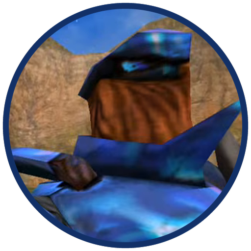

<p align="center"></p>

<h1 align="center">Hunter Importer</h1>

<p align="center"><i>Hunters always come in pairs. So should Halo players.</i></p>

## Why

[OpenCE](https://github.com/OpenCommunityEdition/OpenCE) plays Halo: Combat Evolved from the
original Xbox disc's maps. Many players do not have the disc anymore, but they have Halo: The
Master Chief Collection (MCC) on Steam.

Hunter Importer takes your Steam copy of MCC and writes the Halo 1 maps as Xbox maps, in a `maps`
folder for OpenCE. The goal is that those players **play together with players who have the
disc**, the campaign first, then multiplayer.

To get there, every map gets the disc's values. Then its gameplay data is compared with the
disc's map through a fingerprint:
- **A map that matches is the disc's map.** It plays online and in co-op with disc players.
- **A map that does not match**, such as Halo PC's rebuilt multiplayer maps, never plays with
  them. It stays MCC's own file, for OpenCE's MCC map support.

## HunterCE

The maps are played with **HunterCE**, the importer's pair: a version of OpenCE, on
[a fork of OpenCE](https://github.com/GDAndres98/OpenCE) (its `mcc-testing` branch). OpenCE itself
needs only a few small changes to play these maps:
- each change is a branch of the fork, offered to OpenCE as its own small pull request;
- HunterCE is all of them together.

The fork's `main` stays equal to OpenCE's.

## Status

Early. The conversion is OpenCE's own code (the fork's `mcc-extractor` branch, in the `opence`
submodule), run once per map. [ROADMAP.md](ROADMAP.md) has the steps; the next is a campaign
whose every level matches the disc.

## Use

You need:
- MCC installed through Steam;
- Python 3;
- an OpenCE build of the `opence` submodule (see its README).

Then:

```sh
python import_mcc.py --game opence/build/windows/halo.exe --from steam --out <game data folder>
```

- **`--from`:** MCC's `halo1` folder, or `steam` to find it.
- **Where the maps go:** to `<game data folder>/maps.partial`, which becomes `maps` only when
  every map is written. An existing `maps` folder is never written over.
- **The report:** at the end, for each map, whether it is the disc's map and whether all its
  parts load.

Only MCC's files are read. Nothing of MCC's is in this repository, and of the disc's only values:
numbers, names, orders and hashes, never pictures, sounds, models or geometry.

## Licence

AGPL-3.0-or-later, as OpenCE, whose code it builds ([LICENSE](LICENSE)). The logo is a frame of
Halo: Combat Evolved (a Hunter; the game is Bungie's); HunterCE's logo is a simple drawing of it.
